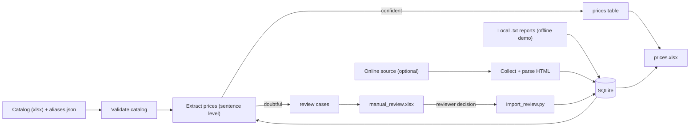

# Pesticide Price Pipeline


A Python pipeline that turns **unstructured Chinese-language market reports** into a **clean, auditable price table** for agrochemical products (herbicides, insecticides, fungicides), quoted in yuan per tonne.

The interesting part is not the scraping — it is the **data-quality layer** around the extraction: every price is traceable to the sentence it came from, doubtful cases go to a human reviewer instead of being guessed, and publishing the outputs is atomic.

> **No data is included.** The repository ships a small example catalog and three
> **synthetic** reports (invented text and prices) so you can run everything offline.

## Quick start

```bash
pip install -r requirements.txt
python demo.py                      # offline: processes examples/sample_reports
python -m unittest discover -s tests
```

`demo.py` writes `exports/prices.xlsx` (sheets: *Preços*, *Relatórios*, *Produtos*) and `exports/manual_review.xlsx` (*Pendentes*, *Resolvidos*, *Verificações*).

Example of what the extractor does with a synthetic sentence:

```
二甲戊灵原药报4.37万元/吨，二甲四氯钠盐货源紧张，报2.28万元/吨以上
→ Pendimethalin  43,700 yuan/t
→ MCPA           22,800 yuan/t     (each price attached to the right product)

草甘膦原药95%含量报2.9万元/吨，97%含量报3万元/吨
→ Glyphosate 95%  29,000      Glyphosate 97%  30,000

灭草松原药以出口为主，报价6.41万元/吨；灭草松水剂480克/升报价2.63万元/吨
→ Bentazone (technical)  64,100      Bentazone (liquid)  26,300
```

## Sample output

Running `python demo.py` on the three synthetic reports produces this table
(also available as Excel in [`examples/output/`](examples/output/)):

| Report date | Product | Concentration | Form | Price (yuan/t) |
|---|---|---|---|---|
| 2025-01-06 | Abamectin | – | technical | 610,000 |
| 2025-01-06 | Chlorpyrifos | – | technical | 22,000 |
| 2025-01-06 | Glufosinate-ammonium | – | technical | 48,000 |
| 2025-01-06 | Glyphosate | 95% | technical | 29,000 |
| 2025-01-06 | Glyphosate | 97% | technical | 30,000 |
| 2025-01-06 | L-Glufosinate | 100% (折百) | base 100% | 62,000 |
| 2025-01-06 | MCPA | – | sodium salt | 22,800 |
| 2025-01-06 | Pendimethalin | – | technical | 43,700 |
| 2025-01-13 | Azoxystrobin | – | technical | 140,000 |
| 2025-01-13 | Bentazone | – | liquid (water-based) | 26,300 |
| 2025-01-13 | Bentazone | – | technical | 64,100 |
| 2025-01-13 | Tebuconazole | – | technical | 75,000 |
| 2025-01-13 | Thiram | – | not specified | 17,000 |

`examples/output/manual_review_sample.xlsx` shows the review workbook. Its
quality-check sheet flags the three tiny synthetic reports as "texto muito curto"
(`ATENÇÃO`) — expected for demo data, and a good example of a check doing its job.

## Architecture



Full details — storage model, processing states and safety mechanisms — in [`docs/ARCHITECTURE.md`](docs/ARCHITECTURE.md).

## Design decisions

- **Conservative extraction.** A product and a price must belong to the same sentence/clause. A price with no recognised product is *not* assigned to the previous product — it becomes a review case.
- **Longest-name-wins matching**, so similar products (e.g. glufosinate vs L-glufosinate, abamectin vs emamectin) are not confused. Explicit concentration (`95%含量报…`) and base-100% (`折百`) rules run before the generic quote rule.
- **Product form is modelled** (technical `原药`, liquid `水剂`, salts, powders…), so a technical-grade price is never averaged with a formulated one.
- **Provenance on every row:** original excerpt, matched name, position, rule applied, confidence, extractor version and catalog version.
- **Human-in-the-loop.** Doubtful cases are written to `manual_review.xlsx`; the reviewer chooses *Incluir / Não incluir / Corrigir* (with a mandatory reviewer name). Approved decisions survive automatic reprocessing. Apply them with `python import_review.py`.
- **Catalog as source of truth.** The product catalog (Chinese / English / Portuguese / category) is validated before every run; duplicates or missing fields stop the process with a clear message. Its hash is stored in the database.
- **Safe publishing.** Outputs are staged, backed up (`.bak`) and swapped as a set; if one replacement fails, previous files are restored.
- **Quality checks** on every run: SQLite integrity, duplicate prices, extreme prices, too many prices for one product in one report, reports with quote words but no price, abnormally short texts, repeated titles.
- **Tested:** 61 unit tests, run on every push by GitHub Actions (extraction edge cases, catalog validation, parser, pagination/partial-failure handling, database reprocessing, review import, atomic publishing).

## Layout

```
src/
  catalog.py          load + validate the product catalog (xlsx) and aliases (json)
  extractor.py        sentence-level product/price association
  database.py         SQLite layer, processing states, review cases, quality checks
  exporter.py         Excel outputs + atomic publishing
  review_importer.py  reads reviewer decisions from the review workbook
  parser.py           HTML → title / date / clean text (validates redirects)
  scraper.py          optional online collector (source configured via env vars)
  pipeline.py         orchestration
catalog/              example catalog (+ optional aliases.json)
examples/sample_reports/   synthetic reports for the offline demo
examples/output/    Excel files generated by the demo (synthetic data)
docs/ARCHITECTURE.md   data flow, storage model, states, safety mechanisms
.github/workflows/  CI: unit tests + demo on Python 3.10 and 3.12
main.py / update.py / import_review.py / demo.py   entry points
```

Processing states per report: `pendente`, `extraido`, `sem_preco_confirmado`, `falha_extracao`, `revisao_manual`.

## Using your own source (optional)

The repo is not tied to any website. To collect online, copy `.env.example` and set `SOURCE_LIST_URL`, `SOURCE_REPORT_URL` and `SOURCE_LINK_REGEX`, then run `python main.py` (full run) or `python update.py` (only new reports). Adapt `src/parser.py` to your source's HTML if needed.

**Check the source's terms of use / robots.txt before scraping, keep the request delay, and do not republish content you do not have rights to.**

You can also feed the pipeline from local text files (see `load_local_reports` in `src/pipeline.py` and the header format used in `examples/sample_reports`).

## Limitations

- Extraction is rule-based (regex + context heuristics), tuned for the sentence patterns of weekly market commentary; new phrasing will need new rules/tests. Ambiguous cases are routed to review rather than guessed.
- Price ranges (`2.75-2.8万元/吨`) and quotes without a quote verb (`报` / `报价` / `暂报`) are not extracted, and currently produce neither a price nor a review case (verified with tests on sample sentences). Supporting them is a good first contribution.
- Code comments and console messages are in Portuguese.

---

### Resumo em português

Pipeline em Python que transforma relatórios de mercado em chinês em uma tabela de preços de defensivos agrícolas (yuan/tonelada), com rastreabilidade de cada preço, revisão humana para casos duvidosos, verificações de qualidade e publicação atômica dos Excels. O repositório não contém dados reais: use `python demo.py` para ver o fluxo com relatórios sintéticos.
