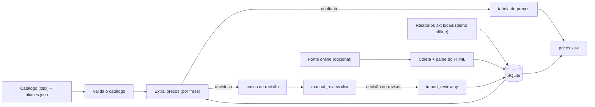

# Pesticide Price Pipeline

[English](README.md) | **Português (Brasil)**


Pipeline em Python que transforma **relatórios de mercado não estruturados, escritos em chinês**, em uma **tabela de preços limpa e auditável** de defensivos agrícolas (herbicidas, inseticidas, fungicidas), cotados em yuan por tonelada.

O mais interessante não é a coleta, e sim a **camada de qualidade de dados** em volta da extração: cada preço é rastreável até a frase de onde veio, casos duvidosos vão para um revisor humano em vez de serem adivinhados, e a publicação dos arquivos de saída é atômica.

> **Nenhum dado real está incluído.** O repositório traz um pequeno catálogo de exemplo e três
> relatórios **sintéticos** (texto e preços inventados) para você rodar tudo offline.

## Início rápido

```bash
pip install -r requirements.txt
python demo.py                      # offline: processa examples/sample_reports
python -m unittest discover -s tests
```

O `demo.py` gera `exports/prices.xlsx` (abas: *Preços*, *Relatórios*, *Produtos*) e `exports/manual_review.xlsx` (*Pendentes*, *Resolvidos*, *Verificações*).

Exemplo do que o extrator faz com uma frase sintética:

```
二甲戊灵原药报4.37万元/吨，二甲四氯钠盐货源紧张，报2.28万元/吨以上
→ Pendimethalin  43.700 yuan/t
→ MCPA           22.800 yuan/t     (cada preço ligado ao produto certo)

草甘膦原药95%含量报2.9万元/吨，97%含量报3万元/吨
→ Glyphosate 95%  29.000      Glyphosate 97%  30.000

灭草松原药以出口为主，报价6.41万元/吨；灭草松水剂480克/升报价2.63万元/吨
→ Bentazone (técnico)  64.100      Bentazone (líquido)  26.300
```

## Exemplo de saída

Rodar `python demo.py` sobre os três relatórios sintéticos gera esta tabela
(também disponível em Excel em [`examples/output/`](examples/output/)):

| Data do relatório | Produto | Concentração | Forma | Preço (yuan/t) |
|---|---|---|---|---|
| 2025-01-06 | Abamectin | – | técnico | 610.000 |
| 2025-01-06 | Chlorpyrifos | – | técnico | 22.000 |
| 2025-01-06 | Glufosinate-ammonium | – | técnico | 48.000 |
| 2025-01-06 | Glyphosate | 95% | técnico | 29.000 |
| 2025-01-06 | Glyphosate | 97% | técnico | 30.000 |
| 2025-01-06 | L-Glufosinate | 100% (折百) | base 100% | 62.000 |
| 2025-01-06 | MCPA | – | sal sódico | 22.800 |
| 2025-01-06 | Pendimethalin | – | técnico | 43.700 |
| 2025-01-13 | Azoxystrobin | – | técnico | 140.000 |
| 2025-01-13 | Bentazone | – | líquido (base água) | 26.300 |
| 2025-01-13 | Bentazone | – | técnico | 64.100 |
| 2025-01-13 | Tebuconazole | – | técnico | 75.000 |
| 2025-01-13 | Thiram | – | não especificada | 17.000 |

O arquivo `examples/output/manual_review_sample.xlsx` mostra a planilha de revisão. A aba de
verificações de qualidade sinaliza os três relatórios sintéticos como "texto muito curto"
(`ATENÇÃO`): é esperado em dados de demonstração e mostra uma checagem cumprindo seu papel.

## Arquitetura



Detalhes completos (modelo de armazenamento, estados de processamento e mecanismos de segurança) em [`docs/ARCHITECTURE.md`](docs/ARCHITECTURE.md), em inglês.

## Decisões de projeto

- **Extração conservadora.** Produto e preço precisam estar na mesma frase ou oração. Um preço sem produto reconhecido *não* é atribuído ao produto anterior: vira um caso de revisão.
- **O nome mais longo vence na busca**, para não confundir produtos parecidos (por exemplo glufosinato e L-glufosinato, abamectina e emamectina). Regras de concentração explícita (`95%含量报…`) e de base 100% (`折百`) rodam antes da regra genérica de cotação.
- **A forma do produto é modelada** (técnico `原药`, líquido `水剂`, sais, pós…), então um preço de produto técnico nunca é misturado com o de um formulado.
- **Origem de cada linha:** trecho original, nome encontrado, posição, regra aplicada, confiança, versão do extrator e versão do catálogo.
- **Humano no circuito.** Casos duvidosos vão para `manual_review.xlsx`; o revisor escolhe *Incluir / Não incluir / Corrigir* (com nome do responsável obrigatório). As decisões aprovadas sobrevivem ao reprocessamento automático. Aplique-as com `python import_review.py`.
- **O catálogo é a fonte da verdade.** O catálogo de produtos (chinês / inglês / português / categoria) é validado a cada execução; duplicidades ou campos ausentes interrompem o processo com mensagem clara. O hash do arquivo fica gravado no banco.
- **Publicação segura.** Os arquivos são preparados, copiados para backup (`.bak`) e trocados em conjunto; se uma substituição falhar, os arquivos anteriores são restaurados.
- **Verificações de qualidade** a cada execução: integridade do SQLite, preços duplicados, preços extremos, preços demais para um produto em um relatório, relatórios com termos de cotação mas sem preço, textos anormalmente curtos e títulos repetidos.
- **Testado:** 61 testes unitários, executados a cada push pelo GitHub Actions (casos de borda da extração, validação do catálogo, parser, paginação e falha parcial, reprocessamento do banco, importação da revisão e publicação atômica).

## Estrutura

```
src/
  catalog.py          carrega e valida o catálogo (xlsx) e os aliases (json)
  extractor.py        associação produto/preço por frase
  database.py         camada SQLite, estados, casos de revisão, verificações
  exporter.py         saídas em Excel + publicação atômica
  review_importer.py  lê as decisões do revisor na planilha de revisão
  parser.py           HTML → título / data / texto limpo (valida redirecionamentos)
  scraper.py          coletor online opcional (fonte configurada por variáveis de ambiente)
  pipeline.py         orquestração
catalog/              catálogo de exemplo (+ aliases.json opcional)
examples/sample_reports/   relatórios sintéticos para a demo offline
examples/output/    Excels gerados pela demo (dados sintéticos)
docs/ARCHITECTURE.md   fluxo de dados, modelo de armazenamento, estados, segurança
.github/workflows/  CI: testes unitários + demo em Python 3.10 e 3.12
main.py / update.py / import_review.py / demo.py   pontos de entrada
```

Estados de processamento de cada relatório: `pendente`, `extraido`, `sem_preco_confirmado`, `falha_extracao`, `revisao_manual`.

## Usando sua própria fonte (opcional)

O projeto não está preso a nenhum site. Para coletar online, copie o `.env.example` e defina `SOURCE_LIST_URL`, `SOURCE_REPORT_URL` e `SOURCE_LINK_REGEX`; depois rode `python main.py` (execução completa) ou `python update.py` (só relatórios novos). Adapte o `src/parser.py` ao HTML da sua fonte, se necessário.

**Confira os termos de uso e o robots.txt da fonte antes de coletar, mantenha o intervalo entre requisições e não republique conteúdo sobre o qual você não tenha direitos.**

Também é possível alimentar o pipeline com arquivos de texto locais (veja `load_local_reports` em `src/pipeline.py` e o formato de cabeçalho usado em `examples/sample_reports`).

## Limitações

- A extração é baseada em regras (regex + heurísticas de contexto), ajustada aos padrões de frase de comentários semanais de mercado; novas formas de escrever exigirão novas regras e testes. Casos ambíguos vão para revisão em vez de serem adivinhados.
- Faixas de preço (`2.75-2.8万元/吨`) e cotações sem verbo de cotação (`报` / `报价` / `暂报`) não são extraídas e, hoje, não geram preço nem caso de revisão (verificado com testes em frases de exemplo). Suportá-las é uma boa primeira contribuição.
- Os comentários do código e as mensagens do console estão em português; a documentação de arquitetura está em inglês.
