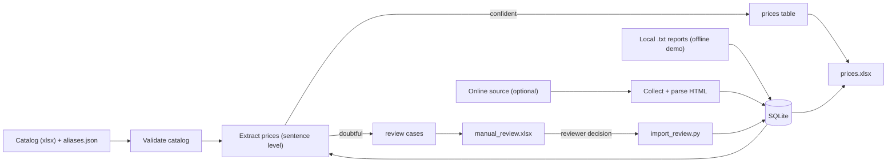
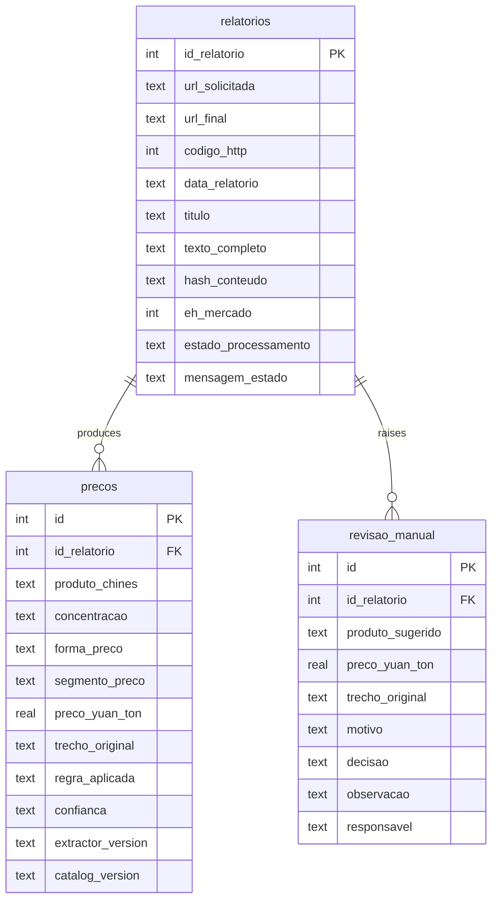
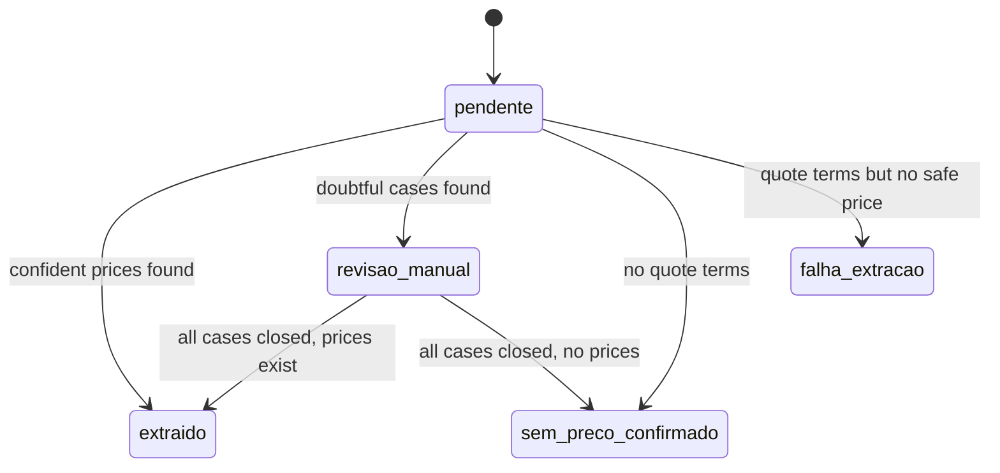

# Architecture

This document explains how data moves through the pipeline, how it is stored, and why the design favours *auditability over automation*.

## 1. Data flow

**Stages**

1. **Validate catalog** – the product catalog (Chinese / English / Portuguese / category) is read and checked. Missing fields, duplicated names or missing sheets stop the run with a readable message. The file hash becomes the *catalog version* stored with every price.
2. **Collect** – either the optional online collector (`src/scraper.py`) or local text files (`load_local_reports`). Reports are stored raw, together with a content hash.
3. **Extract** – each market report is split into sentences/clauses. A product and a quote must belong to the same clause; names are matched longest-first; concentration (`95%含量`), base-100% (`折百`) and product form (technical, liquid, salt, powder…) are detected.
4. **Route** – confident results become rows in `precos`; anything ambiguous becomes a row in `revisao_manual` instead of being guessed.
5. **Review** – a human opens `manual_review.xlsx`, picks *Incluir / Não incluir / Corrigir* and writes their name. `import_review.py` applies the decisions; they survive later automatic reprocessing.
6. **Publish** – Excel files are built in a staging area, backed up, and swapped as a set (all-or-nothing).

## 2. Storage model

A fourth table, `metadata`, stores key/value pairs (`schema_version`, `extractor_version`, `catalog_version`, `catalog_hash`, `catalog_modified_at`). Columns are abbreviated above; see `src/database.py` for the full schema.

### Why this shape

- **Raw text is kept** in `relatorios`, so extraction can be re-run after a rule or catalog change without collecting again.
- **Every price carries its evidence** (`trecho_original`, `regra_aplicada`, `confianca`) and the **versions** that produced it, so any number can be traced and reproduced.
- **Review cases are first-class data**, not log lines, which is what allows decisions to persist across reprocessing.

## 3. Report processing states

Only reports flagged as market reports (`eh_mercado = 1`, i.e. containing quote vocabulary) are processed. Others stay `pendente` and are simply ignored — in the sample data, report `1003` is an example.

## 4. Safety mechanisms

| Concern | Mechanism |
|---|---|
| Partial outputs | Staged files, `.bak` backups and rollback if any replacement fails |
| Reviewer work lost on reprocessing | Manual decisions are stored in the database and never overwritten by automatic rules |
| Unreviewed decisions overwritten by a new export | The export refuses to run while the review workbook contains decisions not yet imported |
| Source goes down mid-run | Collection is marked *partial*; reports already fetched are processed; the last valid Excel files are kept |
| Redirect to another report | Requested ID is compared with the final/canonical ID; mismatches are rejected |
| Silent data drift | Quality checks on every run (duplicates, extreme prices, too many prices per product, short texts, repeated titles, DB integrity) |
| Wrong catalog | Validation stops the run; catalog hash is recorded with each result |

## 5. Known limits

- Rule-based extraction tuned for weekly market-commentary phrasing; new phrasing needs new rules and tests.
- Price ranges (`2.75-2.8万元/吨`) and quotes without a quote verb are currently not extracted and do **not** raise a review case.
- Only reports containing quote vocabulary are processed.
